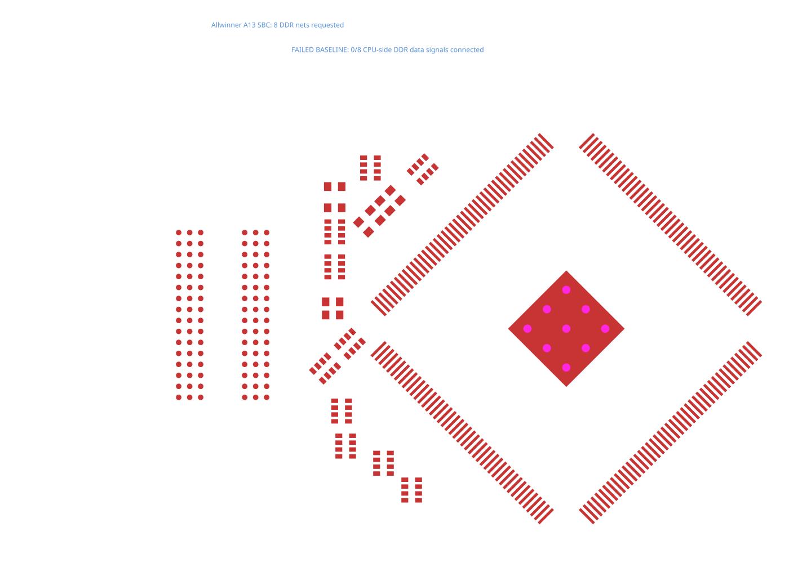

# A13 CPU-side DDR data byte

The real [Allwinner A13 board](https://github.com/vd-rd/sbc_allwinner_a13/blob/8973c32c64349515da64e268cc03ea8c0789ca2a/hardware/module.kicad_pcb), expressed in [board.tsx](board.tsx), retains its original placements, all 378 extracted pads and all 96 source nets. This repro requests only d00–d07, between the CPU and its series-resistor networks. It does not claim an end-to-end CPU-to-RAM byte or DDR timing closure.

Published `tscircuit@0.0.3107` / core `0.0.2288` / bus-lanes-solver `0.0.45` fails with no completed routes. The visibility router encloses the 45° rectangular pads in horizontal/vertical boxes, closing legal space beside the pins. Pad geometry and the original 0.2 mm clearance, 0.1016 mm trace width and no-via-in-pad rules remain unchanged.

The regression uses the [exact Core phase input and original Circuit JSON](../../tests/fixtures/a13-cpu-byte0). Its SVG renders native pads and only fully validated routes. The deliberately failed baseline shows no candidate copper; the stacked fix updates the same SVG after connectivity and DRC pass.



```sh
bun test tests/a13-cpu-byte0.test.ts --timeout 120000
# Run the original TSX through the published Core stack:
bunx tscircuit build repros/a13-cpu-byte0/board.tsx
```

[Source and capture provenance](../../tests/fixtures/a13-cpu-byte0/provenance.json). No length-matching or impedance constraints are invented for this capture.
