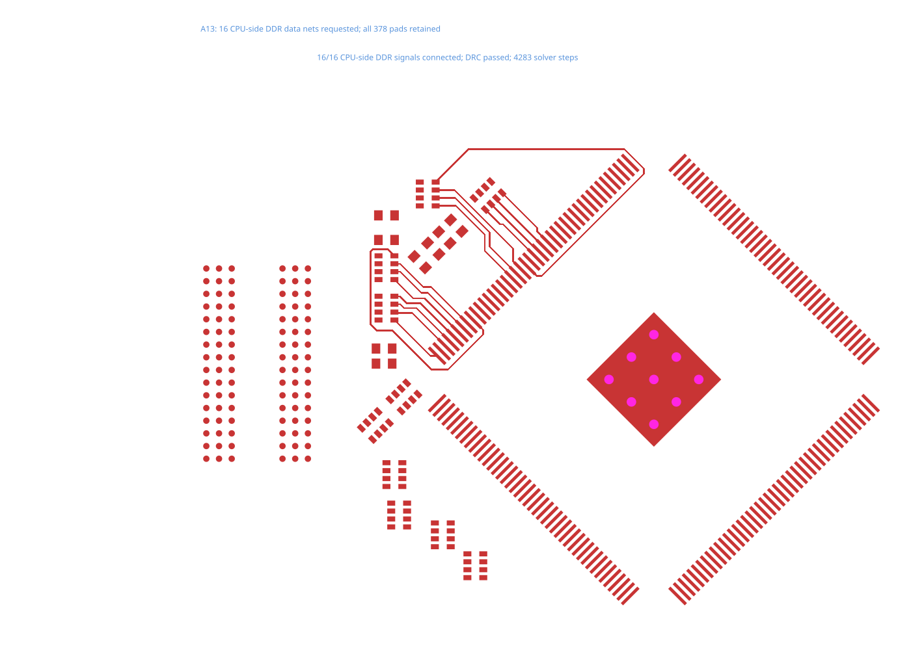

# A13 CPU-side DDR data bytes

[board.tsx](board.tsx) requests both CPU-side data bytes of the real Allwinner A13 board together: 16 connections from CPU pins to series-resistor networks. It reuses the original source circuit, retaining the RAM, all 378 native pad primitives and all 96 source traces. Both top and bottom copper remain allowed. No timing constraints are added.

The surface-site search runs for buses without timing constraints, exhausts its candidates, then ordinary lane routing completes the board. This reproduction captures that wasted work while showing only the completed, validated copper.



```sh
bun test tests/a13-cpu-bytes.test.ts
# Recreate the original TSX through Core:
bunx tscircuit build repros/a13-cpu-bytes/board.tsx
```

The test uses the [exact request captured from Core](../../tests/fixtures/a13-cpu-bytes/provenance.json). Connectivity and DRC must pass before writing the SVG. The caption records solver steps, so the stacked fix shows the reduction without inventing a copper change. This is a CPU-to-resistor section, not a completed CPU-to-RAM interface or DDR timing closure.
