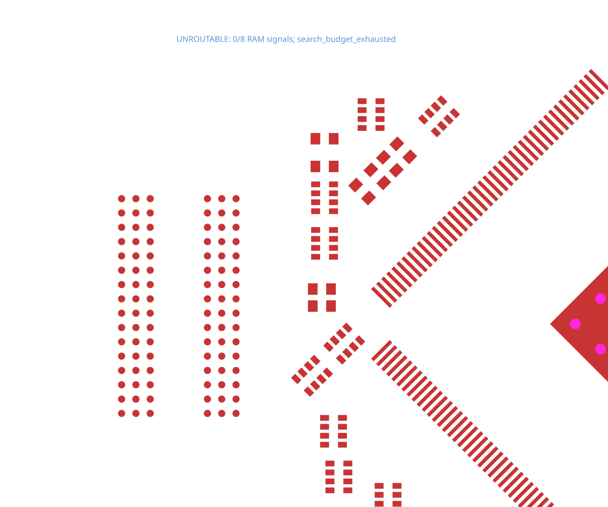

# A13 RAM-side DDR data byte

[board.tsx](board.tsx) requests the eight `ram_byte0` data connections from the
original A13 board. It reuses the captured native parts and keeps all 378 pads,
placements, layers, source nets, widths and via rules.

```sh
bunx tscircuit build repros/a13-ram-byte0/board.tsx
bun test tests/a13-ram-byte0.test.ts --timeout 180000
```

The original 0.20 mm pad clearance encloses RAM ball F2 without a legal trace or
via escape. The baseline SVG deliberately shows zero accepted copper. The
stacked board-rule change will use 0.127 mm (5 mil) clearance explicitly, while
preserving the source project's original rules in the shared source capture.
This is an eight-signal routing reproduction; no DDR timing closure is claimed.

[Capture provenance](../../tests/fixtures/a13-ram-byte0/provenance.json).


