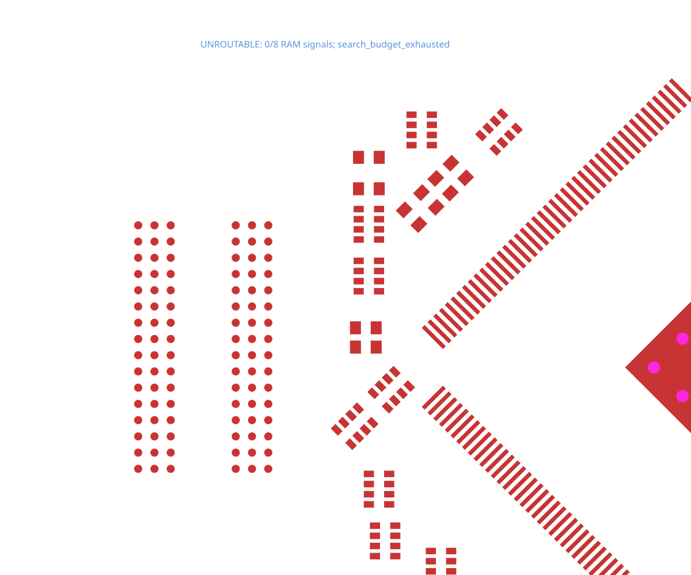

# A13 RAM-side data byte

This variant routes the eight RAM-side data signals with **0.127 mm (5 mil)
pad clearance**. The original KiCad project specifies 0.20 mm for these nets;
that original rule remains recorded in `provenance.json`. This is an explicit
board-rule change, intended for fabrication that supports the chosen clearance.

The [TSX](../../../repros/a13-ram-byte0/board.tsx) retains all 378 native pads,
placements, signal layers, trace widths, 0.45/0.30 mm vias and no-via-in-pad rule.
The input and unrouted Circuit JSON were captured through published
`tscircuit@0.0.3128` / Core `0.0.2312`.

```sh
bunx tscircuit build repros/a13-ram-byte0/board.tsx
bun test tests/a13-ram-byte0.test.ts --timeout 180000
```

At 0.20 mm clearance, the neighboring pads enclose F2 without a legal trace or
via escape. At 0.127 mm, all eight signals complete on TOP without vias. The
snapshot is generated only after complete connectivity and native copper DRC
pass. No timing or impedance constraints are invented.


